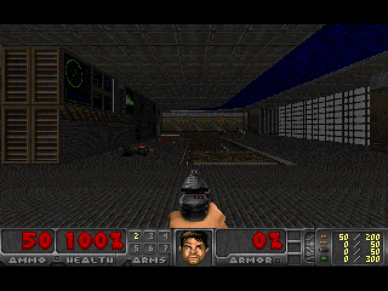
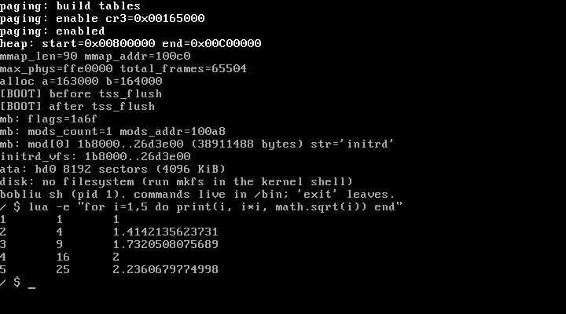
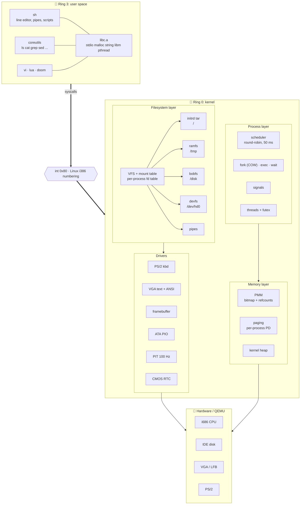
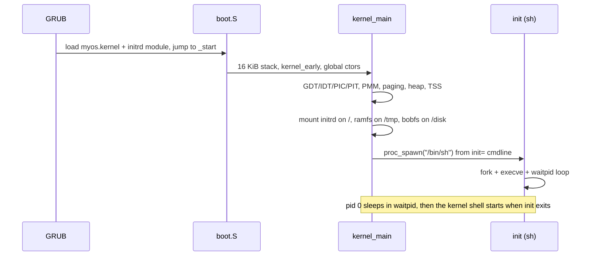
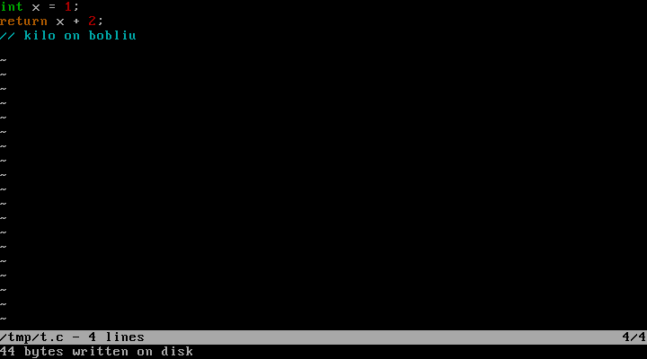

<div align="center">

# 🧠 bobliu OS

### A from-scratch 32-bit x86 operating system that boots, forks, pipes, runs **Lua**, and plays **DOOM**.




*Freedoom running as a ring 3 process on bobliu: framebuffer out, raw scancodes in. Screenshot taken from this repo's own ISO under QEMU.*

[🚀 Quickstart](#-quickstart) · [✨ Features](#-features) · [🏗️ Architecture](#%EF%B8%8F-architecture) · [🎬 Demo script](#-demo-script) · [🗺️ Roadmap](#%EF%B8%8F-roadmap) · [📚 Deep dive](docs/architecture.md)

</div>

---

## 👀 What is this?

bobliu is a hobby kernel written to learn how every layer fits together, following the
[OSDev "Creating an Operating System"](https://wiki.osdev.org/Creating_an_Operating_System)
roadmap, and then pushed well past it. No Linux, no borrowed kernel: its own bootstrap,
interrupts, paging, allocators, scheduler, VFS, filesystems, libc, shell and coreutils.

It boots from GRUB into a **userland shell** (itself an ELF program) with tab completion,
history, pipes, redirection, scripting, `vi`, a Lua 5.1 interpreter and a Doom port.

<p align="center"></p>

```
Bobliu's kernel
bobliu sh (pid 1). commands live in /bin; 'exit' leaves.
/ $ echo hi | tr a-z A-Z
HI
/ $ ls /bin | wc -l
79
/ $ lua -e "for i=1,3 do print(i, i*i, math.sqrt(i)) end"
1       1       1
2       4       1.4142135623731
3       9       1.7320508075689
/ $ doom -warp 1 1 -skill 2
```

> 🛑 **Scope:** single core, VGA text + linear framebuffer, PS/2 keyboard, at most 16 processes.
> It is a learning OS, not a Linux replacement. See [known limitations](#-known-limitations).

## 🚀 Quickstart

**Prereqs:** `i686-elf` cross GCC and binutils in `~/opt/cross/bin`, `i686-elf-grub-mkrescue`,
`xorriso`, `qemu-system-i386`, GNU `make`.

```sh
git clone https://github.com/Bobliuuu/bobliu-os && cd bobliu-os
export PATH="$HOME/opt/cross/bin:$PATH"
export MAKE=make            # scripts default to gmake (macOS/Homebrew)

./iso.sh                    # build libc, kernel, userland, initrd -> bobliu.iso
dd if=/dev/zero of=disk.img bs=1M count=4      # optional ATA disk for bobfs
./qemu.sh                   # build + boot in QEMU
```

The Freedoom IWAD is committed, so a fresh clone builds and runs Doom with nothing extra.

| 🧰 Script | What it does |
|---|---|
| `./iso.sh` | headers → `libc.a`/`libk.a` → kernel → every `user/*.c` → initrd tar → `bobliu.iso` |
| `./qemu.sh` | runs `iso.sh`, boots QEMU (`-d int,cpu_reset -D qemu.log` so triple faults leave a trace) |
| `./clean.sh` | remove build products |

**GRUB menu:**

| Entry | Cmdline | Behavior |
|---|---|---|
| `bobliu (user shell)` ⭐ | `init=/bin/sh` | `/bin/sh` is pid 1; on exit you drop to the kernel shell |
| `bobliu (kernel shell)` | none | kernel shell only |
| `bobliu (noshell)` | `noshell` | no shell, keyboard ignored |

Add a program: drop `user/myprog.c`, rerun `./iso.sh`, run `myprog`.

## ✨ Features

### 🧬 Kernel
- 🥾 **Multiboot 1** boot via GRUB: memory map, cmdline (`init=`, `noshell`), initrd module
- 🧱 **GDT + TSS** with ring 0/3 segments; `esp0` switched per process
- ⚡ **IDT / ISRs / IRQs**: exceptions 0-31, remapped 8259 PIC, 100 Hz PIT, `int 0x80` syscalls
- 🧠 **Memory**: bitmap PMM, paging (kernel identity-mapped 256 MiB, per-process user space), first-fit heap with coalescing
- 🛡️ **Hardening**: kernel-stack **guard pages**, `CR0.WP`, ring 3 faults kill only the offender
- 🐄 **Copy-on-write `fork`** with per-frame refcounts
- 🔁 **Preemptive round-robin scheduler** (50 ms slices), `swtch()` context switching
- 🧵 **Threads**: `clone`-style kernel threads, `pthread` create/join, mutex, condvar on a futex
- 📬 **Signals**: `kill`, `signal`, `sigreturn`, Ctrl-C, interrupts blocking calls
- 🕐 **Time**: CMOS RTC + PIT clock, `nanosleep`, `clock_gettime`
- 🖥️ **Console**: ANSI-capable VGA terminal, termios-ish tty (raw mode, winsize, `isatty`), `poll`, `O_NONBLOCK`
- 🎨 **640x480x32 framebuffer** and raw key up/down events

### 💾 Storage
- 📦 **tar initrd** (read-only) and **ramfs** on `/tmp` behind a **VFS** with a mount table
- 💽 **ATA PIO driver** exposed as `/dev/hd0`
- 🗄️ **bobfs**: own on-disk filesystem (1 KiB blocks, 128 inodes, 12 direct + 1 indirect) on `/disk`
- 🔌 **Pipes** (4 KiB ring buffer, blocking, EOF/EPIPE) and fd inheritance with `dup`/`dup2`

### 📚 Userland
- 🧰 **Own libc**: stdio (`FILE`, `printf` with floats), `malloc`, string, ctype, `qsort`, `scanf` family, `setjmp`, time, **musl libm**
- 🐚 **`sh`**: quoting, `$VAR`, globbing, `&& || ;  &`, `2>&1`, `if/for/while`, scripts, raw-mode line editor with **history and Tab completion**
- 🛠️ **79 programs**: `ls cat grep sed sort uniq find diff xxd head tail tr cut xargs more expr test printf ...`
- ✏️ **`vi`**: normal / insert / `:` modes
- 🌈 **`kilo`**: antirez's tiny editor ported unmodified except for 2 lines, with C/Lua-style syntax highlighting, search, Ctrl-S save
- 🌙 **Lua 5.1** interpreter
- 👹 **Doom** (doomgeneric + Freedoom), ~60 fps under QEMU

## 🏗️ Architecture



### 🥾 Boot sequence



### 🗺️ Virtual address space

```
0x00000000 ┌──────────────────────────────┐
           │ kernel + identity map 256 MiB│  shared by every address space
0x10000000 ├──────────────────────────────┤
           │ user ELF segments + stack    │  per-process page tables
0x20000000 │ user heap (brk / malloc)     │
0x40000000 ├──────────────────────────────┤
           │            ...               │
0xE0000000 ├──────────────────────────────┤
           │ kernel stacks (16 KiB each)  │  each preceded by an unmapped guard page
           └──────────────────────────────┘
```

### 📞 Syscalls

Numbered like Linux i386, called through `int 0x80`.

| Area | Calls |
|---|---|
| Process | `exit` `fork` `execve` `waitpid` `getpid` `clone` `futex` `sched_yield` `kill` `signal` `sigreturn` |
| Files | `open` `close` `read` `write` `lseek` `stat` `readdir` `unlink` `mkdir` `chdir` `getcwd` |
| FDs | `dup` `dup2` `pipe` `fcntl` `poll` |
| Memory | `brk` |
| Time | `time` `clock_gettime` `nanosleep` |
| TTY / display | `tcgetattr` `tcsetattr` `tcsetraw` `fb_init` `fb_exit` |

Full details, data structures and diagrams of fork/exec/wait, the scheduler, the interrupt path and
the VFS live in **[docs/architecture.md](docs/architecture.md)**.

### 🗂️ Repo layout

```
kernel/arch/i386/   boot.S swtch.S isr_stubs.S linker.ld
                    cpu/ (gdt idt isr proc signal user_exec)   mm/ (pmm paging heap syscall)
                    dev/ (console keyboard timer pic vga fb ata rtc)   fs/ (vfs ramfs bobfs pipe ...)
                    shell/ (kernel shell)  interrupts/  tss/
kernel/kernel/      kernel.c (kernel_main)
libc/               libk.a (kernel) and libc.a (user) + headers, musl libm
third_party/        vendored kilo editor
user/               sh, coreutils, vi, test programs (built into initrd/bin)
doom/  lua/         vendored doomgeneric (+ platform layer) and Lua 5.1
toolchain/          crt0.S, user.ld, i686-bobliu-gcc wrapper
docs/               architecture.md, screenshots
```

<p align="center"></p>

## 🎬 Demo script

A 3 minute tour that shows off the whole stack:

```sh
# 1. boot, then show the OS is real
uname -a ; cat /hello.txt ; ls /bin | wc -l

# 2. processes: copy-on-write fork, 40 short-lived children
forktest

# 3. pipes and the shell language
ls /bin | grep test | sort | head -n 5
for f in a b c ; do echo $f > /tmp/$f ; done ; cat /tmp/a /tmp/b /tmp/c

# 4. persistent filesystem (kernel shell: run `mkfs` once, then reboot)
echo persisted > /disk/note ; cat /disk/note

# 5. edit code with syntax highlighting, save, quit, read it back
kilo /tmp/t.c      # Ctrl-S save, Ctrl-Q quit
cat /tmp/t.c

# 6. an interpreter running on top of it all
lua -e "for i=1,5 do print(i, i*i, math.sqrt(i)) end"

# 7. the finale
doom -warp 1 1 -skill 2
```

**Doom controls:** arrows move/turn · Ctrl fire · Space use · Shift run · Alt strafe · 1-7 weapons · Esc menu.

## 🧪 Test programs

Run any of these inside bobliu; each prints its own pass/fail lines.

| Test | Covers |
|---|---|
| `forktest` | COW fork, exec, exit status, 40 forks without leaking frames |
| `fdtest` | `dup`/`dup2`, shared offsets, no fd leak |
| `memtest` | `brk`, `malloc`/`free`, COW heap |
| `wtest` | writes, append, truncate, unlink, read-only initrd |
| `pipetest` `sigtest` `threadtest` `timetest` `polltest` | pipes, signals, threads, time, poll |
| `stdiotest` `floattest` `envtest` `ttytest` | libc stdio, floats and libm, environment, termios |
| `crash` | bad syscall args and NULL writes kill only the offender |

## 🗺️ Roadmap

Mapped to the OSDev phases. Status reflects what is in the tree.

| Phase | Milestone | Status |
|---|---|---|
| I | Bare bones, Multiboot, GDT, memory, interrupts, keyboard, VFS | ✅ |
| II | Ring 3, ELF loader, syscalls, toolchain, libc, fork/exec, shell, file syscalls | ✅ |
| II | COW fork, stack guards, `brk`/`malloc`, writable `/tmp`, ATA disk | ✅ |
| II+ | cwd, pipes, signals, **bobfs**, tab completion, `vi` | ✅ |
| III | Time, threads, framebuffer, full stdio, **Doom**, **Lua**, shell language, 79 programs | ✅ |
| III | termios, environment, `poll`/`select`, unlimited exec loader | ✅ |
| III | **kilo** editor with syntax highlighting | ✅ |
| III | **neovim** port | 🚧 in progress, plan in [docs/neovim-port.md](docs/neovim-port.md). POSIX layer, libuv and all pure-C dependencies generated sources and the `nvim` cross-build done (milestones 1-5 of 7). Next: boot it |
| IV | Networking, sound, USB, GUI | 💭 not started |

## ⚠️ Known limitations

Honest list; details in [docs/architecture.md](docs/architecture.md#11-known-limitations).

- Single core, max **16 processes**, **16 fds** each, 16 args of 128 bytes
- `/tmp` is RAM (256 KiB per file); `bobfs` has 128 files, 268 KiB per file, 27 char names, no cache or journal
- stdin is one global console buffer; no process groups
- Kernel-mode exceptions halt the machine; OOM during a COW fault kills the process
- VGA/framebuffer only, no sound, no networking, no serial console

## 📄 License

bobliu's own code is [MIT](LICENSE). Vendored code keeps its own license: doomgeneric (`doom/LICENSE`), Freedoom (`doom/wad/COPYING.txt`), Lua (`lua/LICENSE`), kilo (`third_party/kilo/LICENSE`, BSD-2).

## 🙏 Credits

- 📖 [OSDev wiki](https://wiki.osdev.org/) and its Meaty Skeleton
- 👹 [doomgeneric](https://github.com/ozkl/doomgeneric) and [Freedoom](https://freedoom.github.io/) (BSD licensed IWAD, see `doom/wad/COPYING.txt`)
- 🌈 [kilo](https://github.com/antirez/kilo) by antirez
- 🌙 [Lua 5.1](https://www.lua.org/) (MIT) and [musl libm](https://musl.libc.org/)

<div align="center">

**Built by [@Bobliuuu](https://github.com/Bobliuuu)** · from `_start` to DOOM 🔥

</div>
