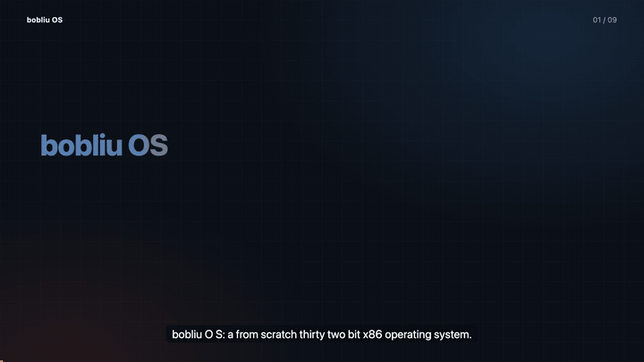
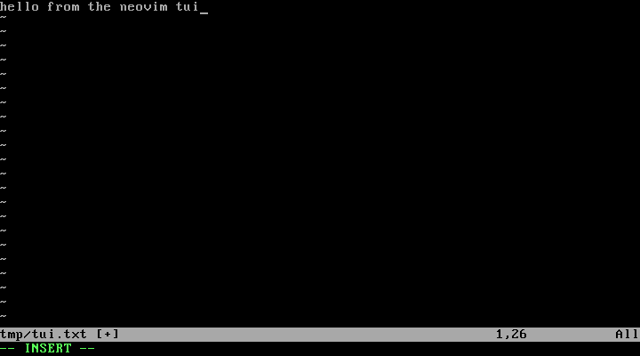
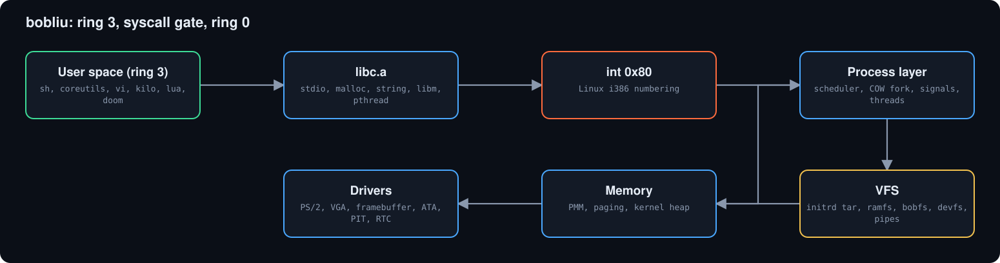
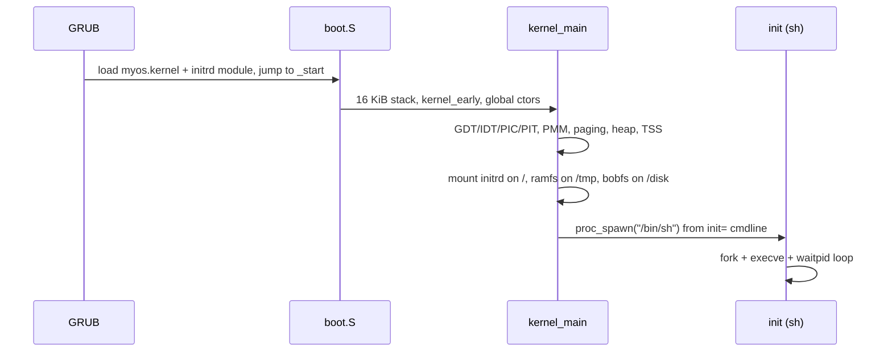
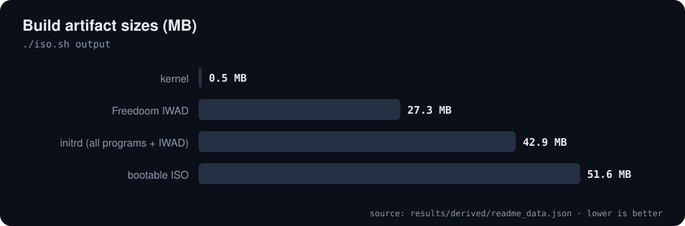
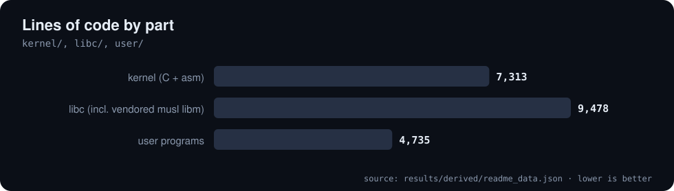

<div align="center">



# 🧠 bobliu OS

**A from-scratch 32-bit x86 operating system that boots, forks, pipes, runs Lua, and plays DOOM**

     [](https://github.com/Bobliuuu/bobliu-os/releases/tag/v0.1.0) [](LICENSE)

[🎬 Video](#video) · [🚀 Quickstart](#quickstart) · [✨ Features](#features) · [🏗️ Architecture](#architecture) · [📊 Build numbers](#numbers) · [🧪 Tests](#tests) · [⚠️ Limitations](#caveats) · [🗺️ Repo map](#repo-map)

</div>

---

**Explainer video (voice-over and captions): what bobliu is, how it is built, what ships, and the limits**

[](video/bobliu_os_explainer.mp4)

<a id="video"></a>
bobliu is a hobby kernel written to learn how every layer fits together, following the [OSDev "Creating an Operating System"](https://wiki.osdev.org/Creating_an_Operating_System) roadmap and then pushed well past it.
No Linux, no borrowed kernel: its own bootstrap, interrupts, paging, allocators, scheduler, VFS, filesystems, libc, shell and coreutils. It boots from GRUB into a **userland shell** with tab completion, history, pipes, redirection, scripting,
`vi`, a Lua 5.1 interpreter, a port of the real Neovim, and a Doom port. A fresh clone builds a **51.6 MB** bootable ISO with **80 programs** in about 15 s on a laptop.

<p align="center"></p>
<p align="center"><sub>Freedoom running as a ring 3 process on bobliu: framebuffer out, raw scancodes in. Screenshot taken from this repo's own ISO under QEMU.</sub></p>

<a id="quickstart"></a>

## 🚀 Quickstart

**Prereqs:** `i686-elf` cross GCC and binutils in `~/opt/cross/bin`, `i686-elf-grub-mkrescue`, `xorriso`, `qemu-system-i386`, GNU `make`.

```sh
git clone https://github.com/Bobliuuu/bobliu-os && cd bobliu-os
export PATH="$HOME/opt/cross/bin:$PATH"
export MAKE=make            # scripts default to gmake (macOS/Homebrew)
./iso.sh                    # build libc, kernel, userland, initrd -> bobliu.iso
dd if=/dev/zero of=disk.img bs=1M count=4      # optional ATA disk for bobfs
./qemu.sh                   # build + boot in QEMU
```
The Freedoom IWAD is committed, so a fresh clone builds and runs Doom with nothing extra.

<p align="center"></p>

| Script | What it does |
|---|---|
| `./iso.sh` | headers, `libc.a`/`libk.a`, kernel, every `user/*.c`, initrd tar, `bobliu.iso` |
| `./qemu.sh` | runs `iso.sh`, boots QEMU (`-d int,cpu_reset -D qemu.log` so triple faults leave a trace) |
| `./clean.sh` | remove build products |

GRUB menu: `bobliu (user shell)` (`init=/bin/sh`), `bobliu (kernel shell)`, `bobliu (noshell)`.

<a id="features"></a>

## ✨ Features

- 🥾 **Multiboot 1** boot via GRUB; 🧱 **GDT + TSS**; ⚡ **IDT / ISRs / IRQs**, 100 Hz PIT, `int 0x80` syscalls
- 🧠 **Memory**: bitmap PMM, paging, first-fit heap; 🛡️ kernel-stack guard pages, `CR0.WP`
- 🐄 **Copy-on-write `fork`**, 🔁 preemptive round-robin scheduler (50 ms), 🧵 threads with futex, 📬 signals
- 💾 **Storage**: tar initrd, ramfs `/tmp`, ATA PIO, **bobfs** (own on-disk filesystem), pipes
- 📚 **Userland**: own libc, `sh` with history and Tab completion, `vi`, `kilo`, Lua 5.1, the real **Neovim 0.10.4** port and **Doom**

<p align="center"></p>
<p align="center"></p>

The complete feature list, syscall table, address-space map and demo script are in [docs/README_FULL.md](docs/README_FULL.md) and [docs/architecture.md](docs/architecture.md).

<a id="architecture"></a>

## 🏗️ Architecture

<p align="center"></p>

<details>
<summary>Boot sequence</summary>



</details>

<a id="numbers"></a>

## 📊 Build numbers

Recorded by `tools/record_build.py`, which runs `./iso.sh` and writes `results/build.json`.

| Bootable ISO | Programs in /bin | Kernel image | Lines written |
|:---:|:---:|:---:|:---:|
| **51.6 MB** | **80** | **453 KB** | **21,526** |

**Code written for this repo (results/build.json)**

| Part | Lines |
| :--- | ---: |
| kernel (C + asm) | 7,313 |
| libc (incl. vendored musl libm) | 9,478 |
| user programs | 4,735 |

<sub>Source: `results/derived/readme_data.json`</sub>

**Build artifacts (results/build.json)**

| Artifact | MB |
| :--- | ---: |
| kernel | 0.5 |
| Freedoom IWAD | 27.3 |
| initrd (all programs + IWAD) | 42.9 |
| bootable ISO | 51.6 |

<sub>Source: `results/derived/readme_data.json`</sub>

<p align="center"></p>

<p align="center"></p>

<a id="tests"></a>

## 🧪 Tests

18 test programs are built into `/bin` and run inside bobliu; each prints its own pass/fail lines (`forktest`, `fdtest`, `memtest`, `wtest`, `pipetest`, `sigtest`, `threadtest`, `timetest`, `polltest`, `stdiotest`, `floattest`, `envtest`, `ttytest`, `crash`, `posixtest`, ...).
Covered: COW fork, exec and 40 forks without leaking frames, fd duplication, `brk`/`malloc`, pipes, signals, threads, time, poll, libc stdio and floats, termios, and ring 3 crashes killing only the offender.
This README does not claim a pass count: the programs are run interactively inside the OS (see [docs/README_FULL.md](docs/README_FULL.md)).

<a id="caveats"></a>

## ⚠️ Honest caveats

- Single core, at most **16 processes**, **16 fds** each, 16 args of 128 bytes.
- `/tmp` is RAM (256 KiB per file); `bobfs` has 128 files, 268 KiB per file, 27 char names, no cache or journal.
- stdin is one global console buffer; no process groups. Kernel-mode exceptions halt the machine.
- VGA/framebuffer only: no sound, no networking, no serial console. The Neovim port runs with an 8-colour terminal, no tree-sitter parsers, no RPC socket and a slow startup (see docs/neovim-port.md).
- Vendored code keeps its own license (doomgeneric, Freedoom, Lua, kilo); bobliu's own code is MIT.

<a id="repo-map"></a>

## 🗺️ Repo map

| Path | What it is |
|---|---|
| `kernel/` | kernel: boot.S, cpu, mm, dev, fs, shell |
| `libc/` | libk.a (kernel) and libc.a (user), headers, musl libm |
| `user/` | sh, coreutils, vi and test programs (built into initrd/bin) |
| `doom/` | vendored doomgeneric, platform layer and Freedoom IWAD |
| `lua/` | vendored Lua 5.1 |
| `ports/` | ported third-party software (Neovim and its dependencies) |
| `toolchain/` | crt0, linker script and the i686-bobliu-gcc wrapper |
| `docs/` | architecture.md, neovim-port.md, screenshots, README_FULL.md (the earlier long README) |
| `tools/` | record_build.py (builds the ISO, records results/build.json) and readme_data.py |
| `README.spec.yml` | spec for video-readme-maker |
| `video/` | explainer mp4, srt, poster, preview.gif (generated) |

---

<div align="center"><sub>Generated with video-readme-maker from README.spec.yml and results/.</sub></div>
