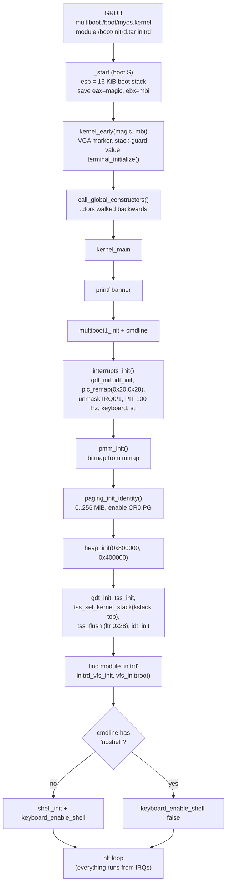
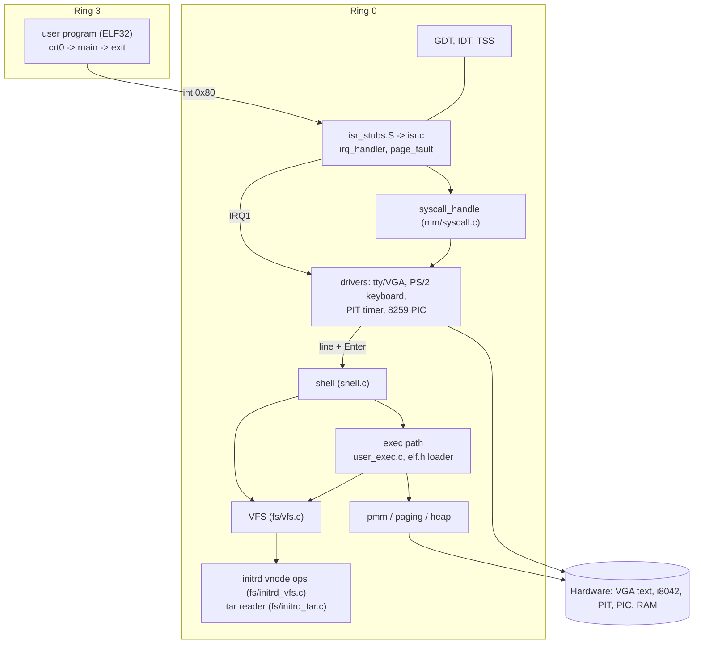
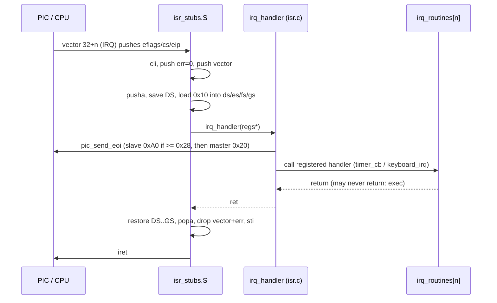
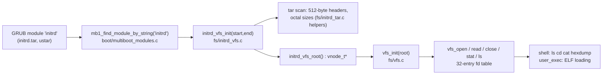
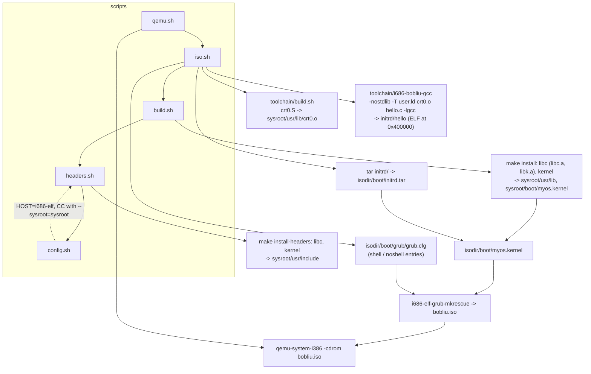

# bobliu architecture

This document describes how the kernel is put together, as implemented in the tree. Source paths
are relative to `kernel/arch/i386/` unless noted. Syscalls and the shell are covered here
(sections 8 and 10) rather than in separate files.

Contents: [1 Boot flow](#1-boot-flow) | [2 Layers](#2-layered-components) |
[3 Memory](#3-memory-layout) | [4 Interrupts](#4-interrupt-and-irq-flow) |
[5 Ring transitions and exec/exit](#5-ring-0--ring-3-exec-and-exit) | [6 TSS/GDT](#6-gdt-and-tss) |
[7 initrd and VFS](#7-initrd-and-vfs) | [8 Syscall ABI](#8-syscall-abi) |
[9 Toolchain and build](#9-toolchain-and-build-pipeline) | [10 Shell](#10-shell) |
[11 Known limitations](#11-known-limitations)

## 1. Boot flow

GRUB loads `/boot/myos.kernel` (Multiboot 1 header requests page-aligned modules and a memory
map) and the initrd as a module named `initrd`. `_start` in `boot.S` sets a 16 KiB boot stack and
calls into C.



Order of operations in `kernel/kernel/kernel.c`, exactly:

1. `printf("Bobliu's kernel")`
2. `multiboot1_init`, `multiboot1_cmdline`
3. `interrupts_init()` (this also does `gdt_init` and `idt_init` and executes `sti`)
4. `pmm_init`, then two throwaway `pmm_alloc_frame` calls that are freed after the heap is up
5. `paging_init_identity()`
6. `heap_init(0x00800000, 0x00400000)`
7. `gdt_init`, `tss_init`, `tss_set_kernel_stack`, `tss_flush`, `idt_init` (second time for GDT/IDT)
8. `multiboot1_dump_modules`, then initrd/VFS setup if a module whose string is `initrd` exists
9. `shell_init` unless `noshell` is on the command line, then the idle `hlt` loop

Interrupts are therefore enabled before the PMM and paging exist. This works because only the
timer and keyboard are unmasked and their handlers do not allocate memory.

## 2. Layered components



The shell is not a process: it runs inside the keyboard IRQ handler. `libk` (`libc/`) provides
`printf`, `string.h` and friends to the kernel only.

## 3. Memory layout

### Physical memory

Managed by a bitmap allocator (`mm/pmm.c`), one bit per 4 KiB frame, first-fit scan.

```
0x00000000 +--------------------------+
           | low 1 MiB (always used)  |  BIOS, VGA at 0xB8000, etc.
0x00100000 +--------------------------+  <- __kernel_start / load address (1 MiB)
           | .text .rodata .data      |
           | .init_array .ctors .bss  |
           | __kernel_end             |
           +--------------------------+
           | PMM bitmap (16-aligned)  |  placed right after __kernel_end
           +--------------------------+
           | multiboot modules        |  marked used (initrd.tar)
           |   (GRUB places them)     |
           +--------------------------+
           | free frames (mmap type 1)|  page directories/tables, user pages
           +--------------------------+
```

The PMM starts with every frame marked used, frees all `type == 1` mmap regions, then re-marks
the first 1 MiB, the kernel image, the bitmap and all modules as used. Total frames come from the
highest end address of available RAM in the memory map.

### Virtual address space

Paging is a 2-level 32-bit scheme with 4 KiB pages. The kernel maps 0..256 MiB as identity
(`KERNEL_ID_MAP_MB = 256`, so PDEs 0..63). Everything above 256 MiB is unmapped. Each user
process gets a page directory cloned from the kernel one (PDEs 0..63 copied, the rest zeroed).

```
0x00000000 +----------------------------------+
           | kernel + low memory (identity)   |
0x00100000 | kernel image, PMM bitmap, ...    |
0x00400000 +----------------------------------+ <- USER_LO: ELF load base (user.ld: . = 0x00400000)
           | user .text .rodata .data .bss    |
0x00800000 +----------------------------------+ <- kernel heap start (heap_init)
           | kernel heap (bump), 4 MiB        |    (0x800000 .. 0xC00000)
0x00C00000 +----------------------------------+
           | ...                              |
0x00FF0000 |  PF_TMP_PT_VA (page fault walker)|
           | ...                              |
0x01FFC000 +----------------------------------+ <- user stack: 4 pages, grows down
           | user stack                       |
0x02000000 +----------------------------------+ <- USER_HI / USER_STACK_TOP (initial user esp)
           | identity-mapped, kernel only     |
0x10000000 +----------------------------------+ <- 256 MiB
           | unmapped                         |
0xFFFFFFFF +----------------------------------+
```

Notes on how this actually behaves (see also [limitations](#11-known-limitations)):

- The "user region" `0x400000..0x2000000` is not a separate range. It sits inside the identity
  map, and user pages are placed there by overwriting entries in the **page tables the clone
  shares with the kernel directory** (the clone copies the PDE values, which point at the same
  page tables). The kernel therefore also sees user mappings after an exec.
- A user page is a freshly allocated physical frame mapped at a user virtual address
  (`paging_alloc_map_in`), not an identity mapping.
- For ring 3 access the PDE and the PTE both need `P_USER`; `get_or_alloc_pt_in` sets `P_USER`
  on the clone's PDE when a user page is mapped. Kernel pages in other PDEs stay supervisor-only.
- All `PT_LOAD` segments are mapped `P_PRESENT | P_USER | P_RW` regardless of `PF_W`.
- `sys_write` accepts buffers only inside `[0x400000, 0x2000000)`.

### Heap

`heap_init(0x00800000, 0x00400000)` gives a bump allocator over `0x800000..0xC00000`. It
reserves PMM frames as the break advances, but ignores which physical frames it received and
simply uses the identity-mapped addresses (see limitations). `kfree` is a no-op.

## 4. Interrupt and IRQ flow

Vectors:

| Vectors | Source | Stub |
|---|---|---|
| 0-31 | CPU exceptions (8, 10-14, 17, 30 push an error code; others get a dummy 0) | `isr0..isr31` |
| 32-47 | 8259 PIC IRQ0-15, remapped by `pic_remap(0x20, 0x28)` | `irq0..irq15` |
| 0x80 | software interrupt, DPL 3 gate (`0xEE`) | `isr128` |

All other gates are `0x8E` (ring 0 interrupt gates). Only IRQ0 (timer, 100 Hz) and IRQ1
(keyboard) are unmasked.



**EOI is sent first.** The shell runs inside `keyboard_irq`, and `exec` from there does not
return through the stub (see section 5). If the EOI were sent last, the PIC would stay
"in service" for IRQ1 and the keyboard would die. `irq_handler` comments say exactly this.

Exceptions go through `isr_common` to `isr_handler(regs_t*)`:

- vector 14: `page_fault_handler` prints CR2, EIP, error bits and walks the page tables, then halts (`cli; hlt` loop)
- vector 0x80: `isr128_handler` -> `syscall_handle`
- other vectors below 32: prints name, EIP/CS/EFLAGS and registers, halts

`isr_common` also contains the exit bounce check after `popa`: see section 5.

## 5. Ring 0 / ring 3, exec and exit

The shell command `exec <path>` calls `user_exec(path)` (`cpu/user_exec.c`).

```mermaid
sequenceDiagram
    participant KB as keyboard IRQ1 (ring 0)
    participant SH as cmd_exec / user_exec
    participant PG as paging
    participant X as exec_enter_usermode<br/>enter_user
    participant U as user program (ring 3)
    participant ST as isr_common (isr_stubs.S)
    participant R as exec_return_to_shell
    KB->>SH: shell_on_line("exec /hello")
    SH->>PG: paging_clone_directory(kernel dir)
    SH->>SH: elf_load_image: read file via VFS into kmalloc(512 KiB)
    SH->>PG: map PT_LOAD pages + 4 stack pages in new dir
    SH->>PG: switch to new dir, copy/zero segments, switch back
    SH->>PG: switch to new dir, g_exec_kcr3 = CR3
    SH->>X: exec_enter_usermode(entry, 0x2000000)
    X->>X: g_exec_kesp = esp, g_exec_resume_eip = exec_resume_after_user
    X->>U: enter_user: build iret frame SS=0x23 ESP CS=0x1B EIP, IF=1; iret
    U->>ST: int 0x80 (eax=4 write) via TSS esp0 stack
    ST->>U: iret (syscall returns in eax)
    U->>ST: int 0x80 (eax=1 exit)
    ST->>ST: syscall_handle sets g_user_exited=1, return
    ST->>ST: popa, add esp 8, see g_user_exited != 0
    ST->>R: clear flag, esp = g_exec_kesp, sti, jmp g_exec_resume_eip
    R->>R: keyboard_enable_shell(true), print prompt, sti, hlt loop
```

Key points:

- `elf_load_image` checks the ELF magic, ELF32 and little-endian, bounds-checks program headers and segment file ranges, maps pages for each `PT_LOAD` plus four stack pages ending at `0x2000000`, then copies file bytes and zeroes the BSS-style tail while the new directory is active.
- `enter_user` loads user data selectors (`0x23`) and builds the `iret` frame with CS=`0x1B`, SS=`0x23`, IF set. It never returns.
- `crt0.S` (`_start`) calls `main`, then issues `SYS_exit` with the return value in `ebx`.
- On ring 3 to ring 0 transitions the CPU loads `esp0` from the TSS: the static 4 KiB `kstack` in `kernel.c`. That stack is reset on each entry because it is never used for long-lived frames.
- `SYS_exit` does not tear down anything in the syscall handler. It sets `g_user_exited`; after `isr_common` has unwound its own frame, it notices the flag, clears it, **replaces `esp` with the stack pointer saved by `exec_enter_usermode`**, re-enables interrupts and jumps to `exec_resume_after_user`, which jumps to `exec_return_to_shell`.
- `exec_return_to_shell` re-enables the shell, prints a prompt and idles in `hlt`. The original call chain (IRQ stub, `irq_handler`, `keyboard_irq`, `shell_on_line`, `cmd_exec`, `user_exec`) is simply abandoned. The code after `exec_enter_usermode` in `user_exec`, and after `user_exec` in `cmd_exec` (the `FINISHED` print), is unreachable on success.
- `g_exec_kcr3` is stored at exec time. `user_bounce.S` has a `usermode_return_to_kernel` routine that would restore it, but the live exit path (`isr_common`) does not; the CR3 restore there is commented out.
- `syscall_exit_bounce` (`interrupts/syscall_exit.c`, prints `[proc exited]`) is dead code: nothing calls it. After a program exits you see a newline and a fresh prompt, with no exit message.

## 6. GDT and TSS

| Index | Selector | Descriptor |
|---|---|---|
| 0 | 0x00 | null |
| 1 | 0x08 | kernel code, ring 0, base 0, limit 4 GiB (`0x9A`, `0xCF`) |
| 2 | 0x10 | kernel data, ring 0 (`0x92`) |
| 3 | 0x18 | user code, ring 3 (`0xFA`); used as `0x1B` with RPL 3 |
| 4 | 0x20 | user data, ring 3 (`0xF2`); used as `0x23` |
| 5 | 0x28 | 32-bit available TSS (`0x89`), `ss0 = 0x10`, `esp0` = top of `kstack`, no I/O bitmap |

`tss_flush` executes `ltr` with `0x28`. The ring 0 segments are flat; protection between
user and kernel is done by paging (`P_USER` bits) only.

## 7. initrd and VFS



- The VFS is a vnode interface: `read(vn, off, buf, len)`, `readdir(vn, index, name, max)`, `lookup(dir, name)`. A vnode carries ops, an `fs_data` pointer, size and an `is_dir` flag.
- `vfs_resolve` walks an absolute path component by component through `lookup`. Relative path handling (`.`, `..`, cwd) is done by the shell (`shell_canon_path`), not the VFS.
- There is a single global fd table of 32 entries, shared by the kernel. User programs do not have file descriptors; there is no `open`/`read` syscall.
- The initrd backend scans the tar on every lookup and directory read (no index). It is read-only.
- The tar is built by `iso.sh` from `initrd/`, with macOS metadata stripped (`COPYFILE_DISABLE`, `--no-xattrs`, `--exclude=._*`).

## 8. Syscall ABI

Defined in `kernel/include/kernel/syscall.h`, shared by kernel and user programs. Numbers follow
Linux i386.

| Register | Role |
|---|---|
| `eax` | syscall number on entry, return value on exit (`-1` on error) |
| `ebx`, `ecx`, `edx` | arguments 1, 2, 3 |
| `int $0x80` | trap instruction (DPL 3 gate) |

| Nr | Name | Args | Behavior |
|---|---|---|---|
| 1 | `SYS_exit` | `ebx` = status (ignored) | sets `g_user_exited`, returns to the shell via the exec bounce |
| 4 | `SYS_write` | `ebx` = fd (1 or 2), `ecx` = buf, `edx` = len | writes to the VGA terminal via `putchar`; fd 1 and 2 are identical; returns `len`, or `-1` for another fd or a buffer outside `0x400000..0x2000000` |
| 20 | `SYS_getpid` | none | always returns `1` |
| other | | | returns `-1` |

The header also provides `__syscall3(num, a, b, c)` as an inline helper for user programs;
`initrd/hello.c` uses it. The exit status is not recorded anywhere. There is no `read` syscall,
so user programs cannot take input.

## 9. Toolchain and build pipeline



- `config.sh` defaults `HOST` to `i686-elf` (`default-host.sh`), `MAKE` to `gmake`, and wraps the compiler with `--sysroot` and `-isystem`. Compilers come from `PATH`; put `~/opt/cross/bin` on it.
- The kernel is linked with `kernel/arch/i386/linker.ld`: load address 1 MiB, page-aligned sections, `__kernel_start`/`__kernel_end` for the PMM, `.init_array`/`.ctors` markers.
- Kernel C is compiled with `-fno-stack-protector`; `libk` is built with `-D__is_libk`. `libc/Makefile` builds both `libk.a` (kernel) and `libc.a` (user space, syscall-backed).
- `toolchain/i686-bobliu-gcc` is not a separate GCC target. It is a wrapper around `i686-elf-gcc` (or `$BOBLIU_CC`) with `-m32 -ffreestanding -fno-pic -fno-stack-protector`, the sysroot headers, and on link: `-nostdlib`, `crt0.o`, `user.ld`, `-lgcc`, and `-lc` only if `sysroot/usr/lib/libc.a` exists.
- `user.ld` places `.text/.rodata/.data/.bss` starting at `0x00400000`, entry `_start`.
- `test.sh` is a stale scratch script referencing files that no longer exist; it is not part of the build.

## 10. Shell

The shell lives in `shell/shell.c` and is driven by the keyboard IRQ: each Enter calls
`shell_on_line(line)`, which tokenizes on spaces (max 16 arguments, 128-character line) and
dispatches through a static table. The prompt is `bobliu:<cwd>> `. See the README for the
command list. `exec` is the only command that leaves the normal return path.

Boot option `noshell` (GRUB menu entry 2) skips `shell_init` and calls
`keyboard_enable_shell(false)`, so Enter does nothing.

## 11. Known limitations

- **Single process.** No scheduler, no `fork`, no wait. `getpid` returns a constant. Only one user program can be in flight, and the shell is blocked (it is stuck inside the IRQ1 handler) until it exits.
- **Exec bounce via saved kernel stack.** `exec_enter_usermode` stores `esp` in a global; exit restores it and jumps to a resume address, discarding the IRQ/shell call chain instead of unwinding it. The `cmd_exec` and `user_exec` epilogues are dead code on success. Nested exec or a second exec while one runs is not supported.
- **No process teardown.** The user page directory, page tables and user frames are never freed; CR3 is not restored to the kernel directory on exit (the clone stays active; it maps the kernel identically so the kernel keeps working).
- **Identity paging only.** The kernel lives in the low 256 MiB, there is no higher-half kernel. The user region is carved out of the identity map and shares page tables with the kernel directory, so address spaces are not truly isolated from each other.
- **Permissions are coarse.** All loaded segments are mapped read/write/user; no NX, no `PF_W` handling, no check of `e_type` or `e_machine`.
- **Heap.** Bump allocator, `kfree` is a no-op, 4 MiB total. `elf_load_image` allocates a 512 KiB scratch buffer per exec and never frees it, so roughly seven execs exhaust the heap. The heap takes frames from the PMM but ignores their addresses and uses `0x800000..0xC00000` directly, so the PMM may hand the same physical frames to something else; the heap range also overlaps the user region in the address map.
- **ABI is minimal.** `write` to fd 1/2 and `exit` and `getpid` only. No `read`, no `open`, no `brk`/`mmap`. User code links `libc.a`; exit status is dropped by the kernel.
- **Exception handling halts.** Every CPU exception and every page fault prints a dump and stops the machine, including those caused by user code. There is no signal or kill path.
- **Interrupt setup is redundant and early.** `gdt_init` and `idt_init` run twice (once in `interrupts_init`, again in `kernel_main` around the TSS), and interrupts are enabled before PMM and paging exist.
- **Input.** US-layout scancode set 1 only; extended (`E0`) keys are ignored. Output is VGA text mode only; no serial console.
- **Stack protector.** Disabled for the kernel build; `ssp.c` and the guard exist but `ssp_init` is not called in `kernel_main`.
- **Dead and test code.** `kernel_old.c`, `boot_old.s`, `linker_old.ld`, `kernel_old.c++`, `kernel/arch/i386/test/*` and `boot/usermode.c` are not part of the build.

### Inconsistencies noticed while documenting

- `help` omits `uptime` and `exec` even though both are registered.
- `syscall_exit_bounce` is unused; `exec_bounce.S` and `user_bounce.S` (which defines its label twice) are alternative resume routines that are not on the live exit path either.
- `grub.cfg` at the repo root (`myos.bin`) is stale; `iso.sh` generates the real one into `isodir/`.
- `paging_translate_in` is declared in `paging.h` but not defined.
- `PAGE_SIZE` and the user stack macros are defined twice in `user_exec.c`.
- `README`-level status for #6 (fork/exec): only the exec half exists, and only through a shell command.
