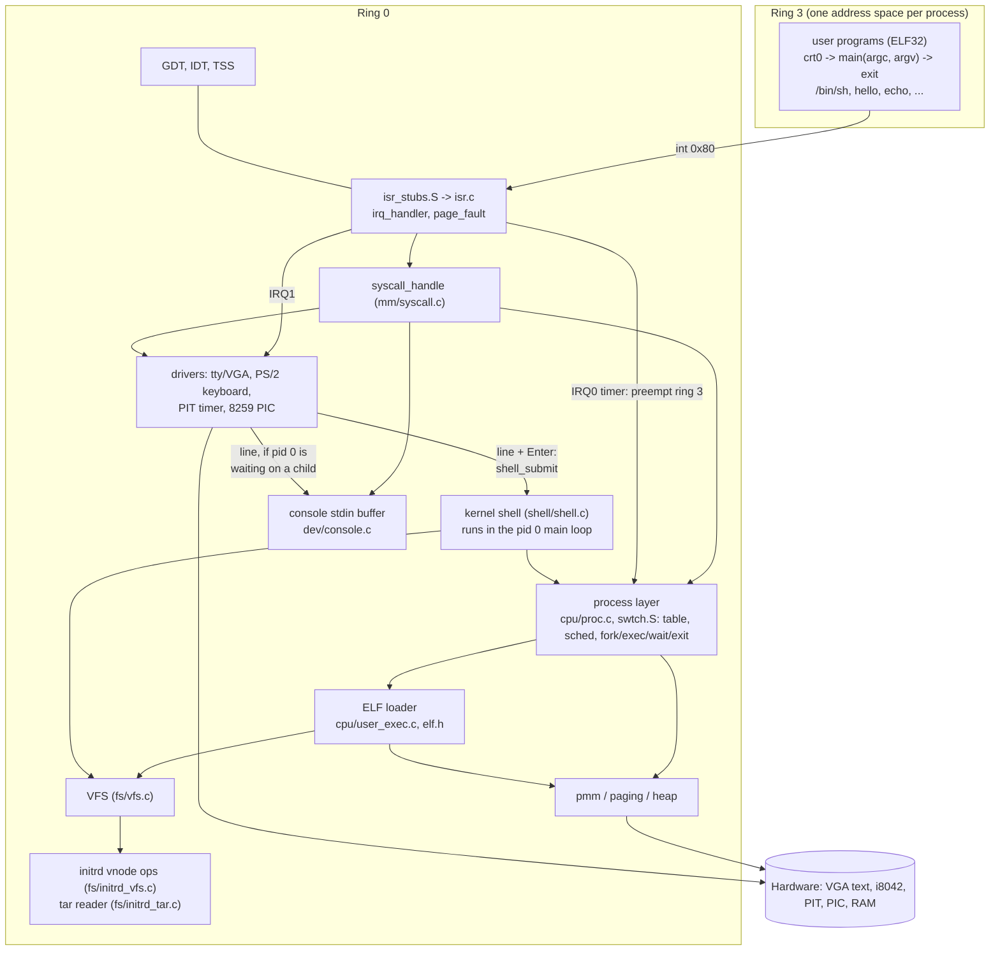
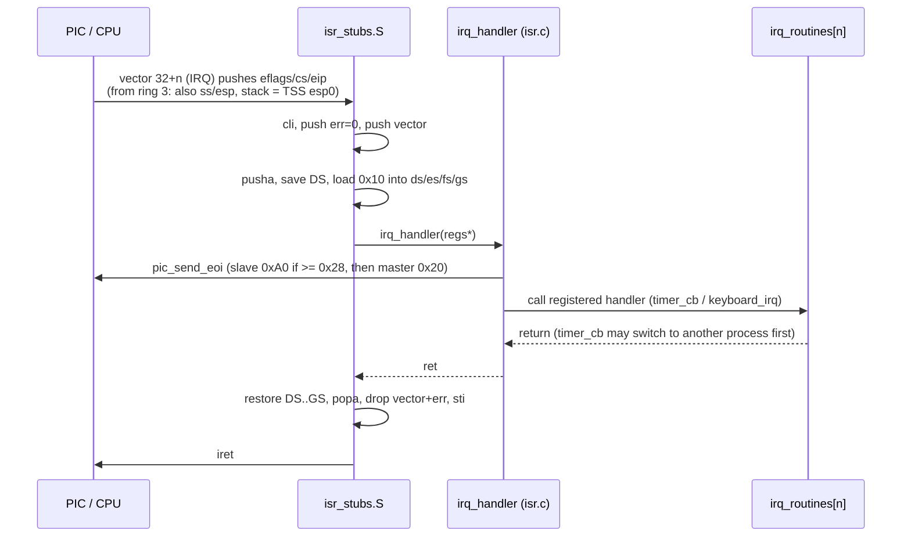
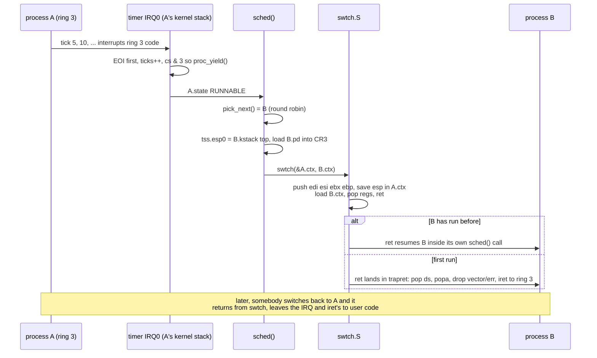
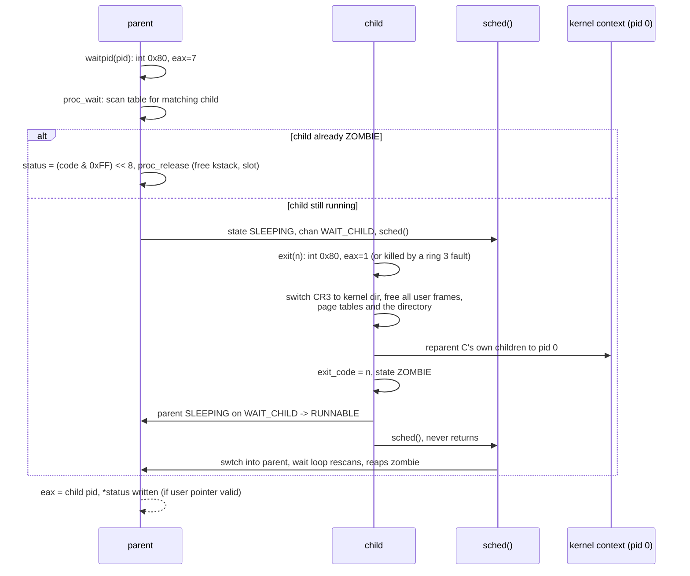
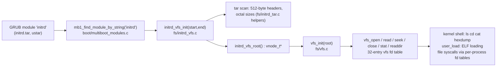
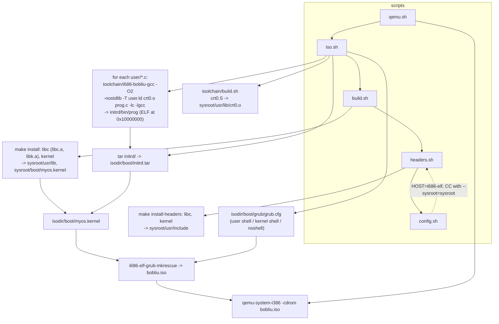

# bobliu architecture

This document describes how the kernel is put together, as implemented in the tree. Source paths
are relative to `kernel/arch/i386/` unless noted. Syscalls and the shells are covered here
(sections 8 and 10) rather than in separate files.

Contents: [1 Boot flow](#1-boot-flow) | [2 Layers](#2-layered-components) |
[3 Memory](#3-memory-layout) | [4 Interrupts](#4-interrupt-and-irq-flow) |
[5 Processes and scheduling](#5-processes-and-scheduling) | [6 TSS/GDT](#6-gdt-and-tss) |
[7 initrd and VFS](#7-initrd-and-vfs) | [8 Syscall ABI](#8-syscall-abi) |
[9 Toolchain and build](#9-toolchain-and-build-pipeline) | [10 Shells and console](#10-shells-and-console) |
[11 Known limitations](#11-known-limitations)

## 1. Boot flow

GRUB loads `/boot/myos.kernel` (Multiboot 1 header requests page-aligned modules and a memory
map) and the initrd as a module named `initrd`. `_start` in `boot.S` sets a 16 KiB boot stack and
calls into C. That boot stack becomes the stack of the kernel context (pid 0) for the rest of
the run.

```mermaid
flowchart TD
    G[GRUB<br/>multiboot /boot/myos.kernel [init=/bin/sh]<br/>module /boot/initrd.tar initrd] --> S["_start (boot.S)<br/>esp = 16 KiB boot stack<br/>save eax=magic, ebx=mbi"]
    S --> E["kernel_early(magic, mbi)<br/>VGA marker, stack-guard value,<br/>terminal_initialize()"]
    E --> C["call_global_constructors()<br/>.ctors walked backwards"]
    C --> K[kernel_main]
    K --> K1[printf banner]
    K1 --> K2[multiboot1_init + cmdline]
    K2 --> K3["interrupts_init()<br/>gdt_init, idt_init, pic_remap(0x20,0x28),<br/>unmask IRQ0/1, PIT 100 Hz, keyboard, sti"]
    K3 --> K4["pmm_init()<br/>bitmap from mmap"]
    K4 --> K5["paging_init_identity()<br/>0..256 MiB, enable CR0.PG"]
    K5 --> K6["heap_init(0x800000, 0x400000)<br/>proc_init() -> pid 0 = this context"]
    K6 --> K7["gdt_init, tss_init,<br/>tss_set_kernel_stack(static 4 KiB kstack),<br/>tss_flush (ltr 0x28), idt_init"]
    K7 --> K8["find module 'initrd'<br/>initrd_vfs_init, vfs_init(root)"]
    K8 --> K9["keyboard_enable_shell(!noshell)"]
    K9 --> K10{"init=PATH on cmdline<br/>and shell enabled?"}
    K10 -- yes --> SP["proc_spawn(PATH), proc_wait(pid)<br/>(kernel context sleeps until it exits)<br/>print [init exited]"]
    K10 -- no --> SI
    SP --> SI["shell_init (unless noshell)"]
    SI --> L["main loop (pid 0):<br/>shell_poll(); proc_reap_orphans(); sti; hlt"]
```

Order of operations in `kernel/kernel/kernel.c`, exactly:

1. `printf("Bobliu's kernel")`
2. `multiboot1_init`, `multiboot1_cmdline`
3. `interrupts_init()` (this also does `gdt_init` and `idt_init` and executes `sti`)
4. `pmm_init`, then two throwaway `pmm_alloc_frame` calls that are freed after the heap is up
5. `paging_init_identity()`
6. `heap_init(0x00800000, 0x00400000)`, then `proc_init()`
7. `gdt_init`, `tss_init`, `tss_set_kernel_stack(kstack)`, `tss_flush`, `idt_init` (second time for GDT/IDT)
8. `multiboot1_dump_modules`, then initrd/VFS setup if a module whose string is `initrd` exists
9. `keyboard_enable_shell(true)` unless `noshell` is on the command line
10. If the command line has `init=<path>` and the shell is enabled: `proc_spawn(path)` and `proc_wait` on it, then print `[init exited]` (or `init: cannot run <path>`)
11. `shell_init` unless `noshell`, then the main loop (`shell_poll`, `proc_reap_orphans`, `sti; hlt`)

Interrupts are therefore enabled before the PMM and paging exist. This works because only the
timer and keyboard are unmasked and their handlers do not allocate memory; the timer handler's
preemption only fires for ring 3 code, which cannot exist yet.

## 2. Layered components



The kernel shell is not a user process: it runs in the kernel main loop (pid 0), outside any
IRQ handler. `libk` (`libc/`) provides `printf`, `string.h` and friends to the kernel;
`libc.a` is the same code plus syscall wrappers for user space.

## 3. Memory layout

### Physical memory

Managed by a bitmap allocator (`mm/pmm.c`), one bit per 4 KiB frame, first-fit scan.

```
0x00000000 +--------------------------+
           | low 1 MiB (always used)  |  BIOS, VGA at 0xB8000, etc.
0x00100000 +--------------------------+  <- __kernel_start / load address (1 MiB)
           | .text .rodata .data      |
           | .init_array .ctors .bss  |
           | __kernel_end             |
           +--------------------------+
           | PMM bitmap (16-aligned)  |  placed right after __kernel_end
           +--------------------------+
           | multiboot modules        |  marked used (initrd.tar)
           |   (GRUB places them)     |
           +--------------------------+
           | kernel heap 0x800000..   |  reserved in the PMM by heap_init
           |            0xC00000      |
           +--------------------------+
           | free frames (mmap type 1)|  page directories/tables, user pages,
           +--------------------------+  per-process kernel stacks
```

The PMM starts with every frame marked used, frees all `type == 1` mmap regions, then re-marks
the first 1 MiB, the kernel image, the bitmap and all modules as used. `heap_init` reserves its
4 MiB range the same way, so the PMM never hands those frames out. Total frames come from the
highest end address of available RAM in the memory map.

Frames carry a reference count (`g_ref[]`, one byte per frame, for the first 512 MiB). A frame
allocated normally has count 1; `pmm_ref_inc` adds a sharer (used by copy-on-write `fork`) and
`pmm_ref` reads the count. `pmm_free_frame` only drops one reference while the count is above 1
and releases the frame when the last reference goes. The count saturates at 255 sharers.

### Virtual address space

Paging is a 2-level 32-bit scheme with 4 KiB pages. The kernel identity-maps 0..256 MiB
(`KERNEL_ID_MAP_MB = 256`, PDEs 0..63). Every process page directory copies those 64 PDEs from
the kernel directory, so they point at the **same page tables** everywhere and kernel memory is
visible (supervisor-only) in every address space. User space is the range
`USER_LO..USER_HI = 0x10000000..0x40000000` (PDEs 64..255), whose page tables are private to
each process. The kernel stacks live in one more region at `KSTACK_BASE = 0xE0000000` (see below). Everything
else is unmapped.

```
0x00000000 +----------------------------------+
           | kernel + low memory (identity)   |  shared PDEs 0..63, supervisor only
0x00100000 | kernel image, PMM bitmap, ...    |
0x00800000 +----------------------------------+ <- kernel heap (heap_init)
           | kernel heap, 4 MiB               |    free list (kmalloc)
0x00C00000 +----------------------------------+
           | ...                              |
0x00FF0000 |  PF_TMP_PT_VA (kernel page fault |
           |   walker, debug only)            |
           | ... frames for page tables and   |
           |     user pages (identity mapped) |
0x10000000 +----------------------------------+ <- 256 MiB: end of identity map, USER_LO
           | user .text .rodata .data .bss    |    ELF load base (user.ld: . = 0x10000000)
           | (grows up; private page tables)  |
           |              ...                 |
           |  unmapped (holes fault)          |
0x3FFF8000 +----------------------------------+ <- user stack: USER_STACK_PAGES = 8, grows down
           | user stack (argc/argv at the top)|
0x40000000 +----------------------------------+ <- USER_HI / USER_STACK_TOP
           | unmapped                         |
0xE0000000 +----------------------------------+ <- KSTACK_BASE, PDE 896, shared by every directory
           | slot 0: [guard][16 KiB stack]    |    guard page is never mapped
           | slot 1: [guard][16 KiB stack]    |    slot i = process table index i
           | ... (KSTACK_SLOTS = 64)          |    each slot is 4 KiB + 16 KiB
           | unmapped                         |
0xFFFFFFFF +----------------------------------+
```

How this behaves:

- A user page is a freshly allocated PMM frame mapped at a user virtual address. For ring 3
  access both the PDE and the PTE need `P_USER`; `get_or_alloc_pt_in` sets it on the PDE when a
  user page is mapped. Kernel PDEs stay supervisor-only.
- The kernel reaches physical frames (page tables, user pages being loaded or copied) through
  the identity map, which is why page tables and user frames are allocated from PMM frames below
  256 MiB in practice (the PMM does not enforce a cap; see limitations).
- Loading and `fork` copy into a not-yet-loaded address space by translating each user address
  to its physical frame and writing through the identity map, so no CR3 switching is needed.
- All `PT_LOAD` segments are mapped `P_PRESENT | P_USER | P_RW` regardless of `PF_W`.
- `user_range_ok` (`mm/syscall.c`) accepts a user buffer only if it lies inside
  `[USER_LO, USER_HI)` and every page it touches is mapped in the caller's directory.
- `paging_free_user` walks PDEs 64..1023 of a directory (skipping the kernel-stack PDE), drops a
  reference on every mapped user frame (a shared frame is only released with its last owner) and
  frees each page table, and optionally the directory frame.
- `CR0.WP` is set in `paging_init_identity`, so ring 0 also faults on writes to read-only pages.
  The copy-on-write logic depends on this, since syscalls write into user buffers.

### Copy-on-write

`P_COW` (`0x200`, a software-available PTE bit) marks a page that is write-protected only because
it is shared after `fork`. `paging_clone_user` builds the child's tables, and for every present
user PTE that is writable it clears `P_RW`, sets `P_COW` in both the parent's and the child's
PTE, and calls `pmm_ref_inc` on the frame; read-only pages are shared as they are. The parent's
TLB is flushed by reloading CR3. No page contents are copied at fork time.

`page_fault_handler` calls `paging_handle_cow(cr2)` first, for a write fault on a present page
(`err & 3 == 3`) inside `[USER_LO, USER_HI)`, from user or kernel mode. If the PTE is read-only
with `P_COW` set: when the frame's refcount is 1 the page is simply made writable again;
otherwise a new frame is allocated, the 4 KiB are copied, one reference on the old frame is
dropped, and the PTE is pointed at the copy with `P_RW` and without `P_COW`. The faulting
instruction then restarts. If no frame can be allocated the handler returns 0 and the fault falls
through to the normal path (a ring 3 process is killed with 139; a ring 0 fault halts).

### Kernel stacks

Each process's 16 KiB kernel stack (`KSTACK_BYTES`) is not on the heap. It lives in the region
starting at `KSTACK_BASE = 0xE0000000`, which is PDE 896 (`KSTACK_PDE`). Its page table is
created once in `paging_init_identity` and the PDE is copied into every directory by
`paging_clone_directory`, so all stacks are visible in all address spaces (`paging_free_user`
and `paging_clone_user` skip this PDE). The region is divided into `KSTACK_SLOTS = 64` slots of
`[1 unmapped guard page][16 KiB stack]`; slot `i` belongs to process table index `i`.
`kstack_alloc(slot)` maps fresh PMM frames for the stack part and returns its lowest address
(0 on OOM); `kstack_free(slot)` unmaps and frees them. Running off the bottom of a stack touches
the guard page, and `page_fault_handler` prints `KERNEL STACK OVERFLOW (guard page hit)` followed
by the usual fault dump and halts. The pid 0 boot stack and the static 4 KiB TSS bootstrap stack
have no guard.

### Heap

`heap_init(0x00800000, 0x00400000)` sets up a first-fit free-list allocator over
`0x800000..0xC00000`. Blocks carry a 16-byte header (size, next, free flag, magic) and payloads
are 16-byte aligned. `kmalloc` splits a large free block; `kfree` marks a block free and
coalesces with the following and preceding free blocks (a bad or double free prints a message
and is ignored). The heap range is identity mapped and its frames are reserved in the PMM.
Heap users: the temporary ELF image buffer and other small kernel allocations (kernel stacks no longer come from the heap).

## 4. Interrupt and IRQ flow

Vectors:

| Vectors | Source | Stub |
|---|---|---|
| 0-31 | CPU exceptions (8, 10-14, 17, 30 push an error code; others get a dummy 0) | `isr0..isr31` |
| 32-47 | 8259 PIC IRQ0-15, remapped by `pic_remap(0x20, 0x28)` | `irq0..irq15` |
| 0x80 | software interrupt, DPL 3 gate (`0xEE`) | `isr128` |

All other gates are `0x8E` (ring 0 interrupt gates). Only IRQ0 (timer, 100 Hz) and IRQ1
(keyboard) are unmasked.



**EOI is sent first.** The timer handler may call `proc_yield()` and switch to another process,
and the interrupted one may not run again for a while. If the EOI were sent last, the PIC would
stay "in service" for IRQ0 and the timer would stop. `irq_handler` has a comment saying this.

The timer (`dev/timer.c`) increments the tick count and, only when the interrupted code was in
ring 3 (`cs & 3`) and `ticks % 5 == 0`, calls `proc_yield()`. Ring 0 code is never preempted.

Exceptions go through `isr_common` to `isr_handler(regs_t*)`:

- vector 0x80: `isr128_handler` path -> `syscall_handle`
- vector 14: `page_fault_handler`. First it tries `paging_handle_cow` (see section 3). Otherwise, from ring 3 it prints `[pid N killed: segfault at ADDR, eip=...]` and calls `proc_exit(139)`. From ring 0 it prints (preceded by `KERNEL STACK OVERFLOW` if CR2 is in a guard page) CR2, EIP, error bits and walks the page tables, then halts (`cli; hlt` loop)
- other vectors below 32: from ring 3, prints `[pid N killed: <name> at eip=...]` and calls `proc_exit(128 + vector)`; from ring 0, prints the name, EIP/CS/EFLAGS and registers, then halts

## 5. Processes and scheduling

### Data structures

`kernel/include/kernel/proc.h`, implemented in `cpu/proc.c` and `swtch.S`.

- A static table of `NPROC = 16` `proc_t` entries. Slot 0 is the **kernel context** (pid 0): it
  has no private kernel stack (it runs on the boot stack) and uses the kernel page directory.
  It is the parent that adopts orphans and the process that runs the kernel shell.
- `proc_t` also holds `fds[PROC_MAXFD]` (`PROC_MAXFD = 16`), the per-process descriptor table
  described in section 7.
- States: `UNUSED`, `RUNNABLE`, `RUNNING`, `SLEEPING` (blocked on a channel: `WAIT_CHILD` or
  `WAIT_CONSOLE`), `ZOMBIE`.
- Each other process owns a **kernel stack** (`KSTACK_SIZE = 16384` bytes, from `kstack_alloc` in
  the guarded kernel-stack region) and a **page directory** (kernel PDEs shared, user PDEs private). Pids come from a counter and are
  never reused within a boot; the shell started by `init=` is pid 1.
- `struct context` holds the callee-saved registers (`edi, esi, ebx, ebp`) plus the return `eip`.
  `swtch(&old->ctx, new->ctx)` pushes those on the old stack, saves `esp`, loads the new `esp`,
  pops and returns.
- A new process's kernel stack is laid out from the top as `[trap frame (regs_t)]` then
  `[context]` below it, with the context's `eip` set to `trapret`.

### Scheduler

`sched()` is round robin over the table starting after the current slot. It disables interrupts,
picks the next `RUNNABLE` entry, sets the TSS `esp0` to the next process's kernel stack top (if
it has one), loads its CR3, and calls `swtch`. If nothing is runnable and the caller is not
itself running, it executes `sti; hlt; cli` until an interrupt makes something runnable.



Processes that block (`waitpid`, `read` on an empty console) set their state to `SLEEPING` with a
channel and call `sched()` directly from inside the syscall. A wakeup (`proc_wakeup(chan)` from
the console on a new line, or `proc_exit` for the parent's `WAIT_CHILD`) makes them `RUNNABLE`.

### fork

```mermaid
sequenceDiagram
    participant P as parent (ring 3)
    participant K as syscall_handle / proc_fork
    participant PG as paging_clone_user
    participant C as child (new slot)
    P->>K: int 0x80, eax=2 (SYS_fork)
    K->>K: proc_alloc: slot, kstack_alloc (guarded 16 KiB),<br/>pid, parent = current, empty fd table
    K->>PG: new directory: copy kernel PDEs, then for every user PTE<br/>share the frame (pmm_ref_inc), writable PTEs become<br/>read-only + P_COW in parent and child; nothing is copied
    K->>C: copy parent's trap frame onto child's kstack, child eax = 0
    K->>C: state = RUNNABLE
    K-->>P: eax = child pid, iret
    Note over C: when scheduled, swtch returns into trapret,<br/>iret: child continues after int 0x80 with fork() == 0
    Note over P,C: first write by either side faults,<br/>paging_handle_cow copies that one page (or just re-enables<br/>write if it is the last owner)
```

On out-of-memory (no slot, no kernel stack, or no frames for page tables) `fork` returns -1 and
releases what it allocated. The child's fd table starts empty: open files are **not** inherited.

### exec

`execve(path, argv, envp)` replaces the calling process's image in place. `syscall_handle`
copies the path and up to `PROC_MAX_ARGS = 16` arguments of at most `PROC_ARG_LEN = 128` bytes
out of user space (each pointer and byte validated with `user_range_ok`); `envp` is not read. If
`argv` is NULL, `argv[0]` is the path. Then `proc_exec`:

1. `user_load` builds a **new** address space (below). On failure nothing has changed and the
   syscall returns -1 to the old program.
2. Switches CR3 to the new directory and frees every user frame and page table of the old one.
3. Rewrites the existing trap frame: `eip` = ELF entry, `useresp` = prepared stack pointer,
   segments set to the ring 3 selectors, `eflags` with IF set. The syscall's `iret` then lands
   in the new program. `eax` stays 0.

`user_load` (`cpu/user_exec.c`):

- `vfs_stat` the path (must be a file, at most 512 KiB), read the whole file into a temporary
  `kmalloc` buffer, freed afterwards.
- Validate: ELF magic, ELF32, little-endian, `ET_EXEC`, `EM_386`, program header size, and that
  the program header table fits in the file. Each `PT_LOAD` must satisfy
  `p_vaddr >= USER_LO`, end at or below `USER_HI` minus the stack, `p_filesz <= p_memsz`, and
  file range inside the image.
- `paging_clone_directory(kernel dir)` for a fresh directory; for each `PT_LOAD` page allocate a
  zeroed frame, map it `P_PRESENT | P_RW | P_USER`, and copy the file bytes through the identity
  map (the BSS tail is already zero). Map 8 stack pages ending at `USER_STACK_TOP`.
- Build the initial stack: argument strings at the top, 16-byte alignment, then
  `argv[0..n-1]`, a NULL, and `argc` below that. The returned stack pointer points at `argc`.
- The entry point must be inside the user range. On any failure the partly built address space is
  freed.

`crt0.S` (`_start`) reads `argc` and `argv` from the stack, calls `main(argc, argv)`, and issues
`SYS_exit` with the return value in `ebx`.

`proc_spawn(path, argv, argc)` (used by the kernel for `init=` and the `exec` command) does the
same `user_load`, then allocates a slot and builds a fresh trap frame (`cs = 0x1B`, `ss/ds =
0x23`, `eflags = 0x202`) for it to `iret` into, and marks it `RUNNABLE`. Its parent is the
current process, i.e. pid 0.

### wait and exit



Details:

- On exit, `proc_exit` also closes every open fd (3 and up) in the process's table.
- A zombie keeps its slot and kernel stack (it is still running on that stack when it calls
  `sched()` the last time) until its parent reaps it in `proc_wait`; `proc_release` then
  releases the stack with `kstack_free`.
- `waitpid(-1, ...)` (also `wait`) accepts any child; `waitpid(pid, ...)` a specific one; both
  return -1 immediately when there is no matching child. The `options` argument is ignored. The
  status is `(exit_code & 0xFF) << 8`, which is what `WEXITSTATUS` in `sys/wait.h` undoes.
- A child that dies from a CPU exception or page fault in ring 3 exits with `128 + vector`
  (`139` for a page fault); nothing else about the other processes is affected.
- Orphans are adopted by pid 0. The kernel main loop calls `proc_reap_orphans()` on every wake-up
  to release zombies whose parent is pid 0 and that nobody waited for.
- `proc_kernel_busy()` reports whether pid 0 is `SLEEPING`. The keyboard path uses it to decide
  where a finished input line goes (section 10).

## 6. GDT and TSS

| Index | Selector | Descriptor |
|---|---|---|
| 0 | 0x00 | null |
| 1 | 0x08 | kernel code, ring 0, base 0, limit 4 GiB (`0x9A`, `0xCF`) |
| 2 | 0x10 | kernel data, ring 0 (`0x92`) |
| 3 | 0x18 | user code, ring 3 (`0xFA`); used as `0x1B` with RPL 3 |
| 4 | 0x20 | user data, ring 3 (`0xF2`); used as `0x23` |
| 5 | 0x28 | 32-bit available TSS (`0x89`), `ss0 = 0x10`, `esp0` set per process, no I/O bitmap |

`tss_flush` executes `ltr` with `0x28`. `esp0` is initially the top of a static 4 KiB `kstack`
in `kernel.c` and is updated by `sched()` to the top of the next process's kernel stack on every
switch to a process that has one. The ring 0 segments are flat; protection between user and
kernel, and between processes, is done by paging (`P_USER` bits and private user page tables).

## 7. initrd and VFS



- The VFS is a vnode interface: `read`, `readdir`, `lookup`, plus optional `write`, `truncate`, `create`, `unlink` for writable filesystems and `put`, which the VFS calls when it is done with a vnode that `lookup`/`create` handed out (initrd vnodes are heap copies that `put` frees). A vnode carries ops, an `fs_data` pointer, size, an `is_dir` flag and a count of open files (`refs`).
- A mount table (`vfs_mount(path, root)`, 4 entries) grafts other filesystems into the tree: `/tmp` is a ramfs, `/dev` is devfs. `walk()` checks the mount table first, then resolves the rest of the path component by component through `lookup`. Relative path handling (`.`, `..`, cwd) is done by the kernel shell (`shell_canon_path`), not the VFS.
- `vfs.c` keeps a global table of 32 open files with a reference count, so `dup` and `fork` share one entry (and one offset) and the file is closed when the last reference goes. `vfs_open_flags` takes `O_RDONLY/O_WRONLY/O_RDWR/O_CREAT/O_TRUNC/O_APPEND`; `vfs_write`, `vfs_unlink` and `vfs_mkdir` go to the filesystem that owns the path, and fail on the read-only initrd. Path-based `vfs_stat` and `vfs_readdir_path` remain. `vfs_seek(fd, off, whence)` takes 0=SET, 1=CUR, 2=END.
- Each process has its own fd table, `proc_t.fds[PROC_MAXFD]` with `PROC_MAXFD = 16`. An entry is a VFS fd (>= 0), `FD_CONSOLE` (-2) or -1 (free). Fds 0-2 start as `FD_CONSOLE` in pid 0, and every new process copies its parent's table, bumping the VFS refcount for file entries; `exec` keeps the table. `proc_fd_dup(old, new)` is `dup2` (new < 0 means lowest free), which is how the shell redirects stdout: open the file, `dup2(fd, 1)`, `close(fd)`, `execv`. All fds are closed in `proc_exit`.
- **ramfs** (`fs/ramfs.c`, mounted on `/tmp`): a tree of nodes with file data in `kmalloc` buffers that double as they grow (256 KiB cap per file). A node removed with `unlink` while still open is freed on the last close. It lives in the kernel heap (4 MiB shared with everything else) and is gone at reboot.
- **devfs** (`fs/devfs.c`, mounted on `/dev`): only `hd0`, present when the ATA probe found a disk. It maps byte offsets to sectors and uses read-modify-write for partial sectors.
- **ATA** (`dev/ata.c`): primary bus, master drive, LBA28, polled PIO with the drive's interrupt disabled. `ata_init` runs `IDENTIFY`, reads the sector count, and rejects ATAPI/SATA signatures. `qemu.sh` attaches `disk.img` (created once by `iso.sh`, 1 MiB); without a disk the kernel prints `ata: no disk` and `/dev` is empty.
- The initrd backend scans the tar on every lookup and directory read (no index). It is read-only.
- The tar is built by `iso.sh` from `initrd/` (including the generated `initrd/bin`), with macOS metadata stripped (`COPYFILE_DISABLE`, `--no-xattrs`, `--exclude=._*`).

## 8. Syscall ABI

Defined in `kernel/include/kernel/syscall.h`, shared by kernel and user programs. Numbers follow
Linux i386.

| Register | Role |
|---|---|
| `eax` | syscall number on entry, return value on exit (`-1` on error) |
| `ebx`, `ecx`, `edx` | arguments 1, 2, 3 |
| `int $0x80` | trap instruction (DPL 3 gate) |

| Nr | Name | Args | Behavior |
|---|---|---|---|
| 1 | `SYS_exit` | `ebx` = status | ends the calling process (zombie until reaped); never returns |
| 2 | `SYS_fork` | none | duplicates the process (copy-on-write: user pages are shared and copied on first write; open files are shared with the child, including their offset); returns the child's pid to the parent and 0 to the child, or -1 |
| 3 | `SYS_read` | `ebx` = fd, `ecx` = buf, `edx` = len | fd 0: blocking, line-buffered read from the console; sleeps until a full line is available and returns up to one line (including the `\n`), at most `len` bytes. a file fd: reads from the open file at its current offset, returns bytes read (0 at EOF). A dup of the console reads the console. -1 for an unopened or write-only fd or a bad buffer |
| 4 | `SYS_write` | `ebx` = fd, `ecx` = buf, `edx` = len | console fds write to the VGA terminal via `putchar`; file fds write through the VFS (appending if opened with `O_APPEND`); returns the bytes written, or -1 (closed fd, read-only file, invalid buffer) |
| 5 | `SYS_open` | `ebx` = path, `ecx` = flags | opens a file (`O_RDONLY/O_WRONLY/O_RDWR`, `O_CREAT`, `O_TRUNC`, `O_APPEND`; Linux values); returns the lowest free fd, or -1 (not found, read-only filesystem, fd table full) |
| 6 | `SYS_close` | `ebx` = fd | closes any open fd (console fds too); 0, or -1 if not open |
| 7 | `SYS_waitpid` | `ebx` = pid (or -1), `ecx` = `int*` status (may be 0), `edx` ignored | blocks until a matching child is a zombie; returns its pid and reaps it; -1 if there is no such child |
| 10 | `SYS_unlink` | `ebx` = path | removes a file or an empty directory (writable filesystems only); 0 or -1 |
| 12 | `SYS_chdir` | `ebx` = path | sets the cwd (must be a directory); 0 or -1 |
| 13 | `SYS_time` | `ebx` = `time_t*` (may be 0) | unix seconds, UTC |
| 11 | `SYS_execve` | `ebx` = path, `ecx` = `argv` (NULL-terminated, may be 0) | replaces the process image; returns only on failure (-1). Up to 16 args of 128 bytes; `envp` is not passed |
| 19 | `SYS_lseek` | `ebx` = fd, `ecx` = offset, `edx` = whence (0 SET, 1 CUR, 2 END) | returns the new offset or -1 |
| 37 | `SYS_kill` | `ebx` = pid, `ecx` = signal | queues a signal (0 only checks the process exists); 0 or -1 |
| 42 | `SYS_pipe` | `ebx` = `int[2]` | creates a pipe: `[0]` read end, `[1]` write end |
| 48 | `SYS_signal` | `ebx` = signal, `ecx` = handler (0 default, 1 ignore), `edx` = restorer | returns the old handler; `SIGKILL` can't be caught |
| 119 | `SYS_sigreturn` | none | called by the libc stub when a handler returns; restores the interrupted registers |
| 162 | `SYS_nanosleep` | `ebx` = `struct bob_timespec*` | sleeps in 10 ms ticks; -1 if a signal ended it early |
| 183 | `SYS_getcwd` | `ebx` = buf, `ecx` = size | copies the cwd; returns its length including the NUL, or -1 |
| 265 | `SYS_clock_gettime` | `ebx` = 0 wall / 1 since boot, `ecx` = `struct bob_timespec*` | 10 ms resolution |
| 120 | `SYS_clone` | `ebx` = `struct bob_clone*` (`fn`, `arg`, `stack_top`, `exit_stub`) | starts a thread in the caller's group; returns its tid |
| 158 | `SYS_sched_yield` | none | gives up the cpu |
| 224 | `SYS_gettid` | none | the calling thread's id |
| 240 | `SYS_futex` | `ebx` = addr, `ecx` = 0 wait / 1 wake, `edx` = value | wait sleeps only if `*addr == value` (checked with interrupts off); wake wakes everything hashed to that address |
| 300 | `SYS_thread_exit` | `ebx` = code | ends this thread; on the main thread it ends the process |
| 301 | `SYS_thread_join` | `ebx` = tid, `ecx` = `int*` code | waits for a thread of this group and frees its slot |
| 20 | `SYS_getpid` | none | the caller's pid |
| 39 | `SYS_mkdir` | `ebx` = path | creates a directory (writable filesystems only); 0 or -1 |
| 41 | `SYS_dup` | `ebx` = fd | another fd for the same open file (lowest free); -1 on error |
| 45 | `SYS_brk` | `ebx` = address | moves the end of the heap (`0x20000000..0x30000000`), zero-filled pages; returns the new break or -1; `brk(0)` returns the current one |
| 63 | `SYS_dup2` | `ebx` = old fd, `ecx` = new fd | makes `new` refer to the same open file as `old`, closing `new` first; returns `new` or -1 |
| 89 | `SYS_readdir` | `ebx` = path, `ecx` = index, `edx` = `char name[128]` | copies the index-th entry name of the directory into `name`; returns 1, 0 past the last entry, or -1 on error |
| 106 | `SYS_stat` | `ebx` = path, `ecx` = `struct bob_stat*` | fills `size` and `is_dir`; 0, or -1 |
| 200 | `SYS_tcsetraw` | `ebx` = 1 or 0 | 1: raw console, `read(0)` returns whatever bytes are queued (blocking for at least one), no echo, no line editing, Ctrl-C arrives as byte 3 instead of SIGINT. 0: cooked. Switching flushes pending input; `proc_exit` resets it to cooked |
| other | | | returns -1 |

The header also provides `__syscall3(num, a, b, c)` as an inline helper; the libc wrappers use
it. All user pointers are checked with `user_range_ok` (inside the user region, every page
mapped) before the kernel touches them.

libc wrappers (`libc/unistd/`, `libc/stdlib/`): `read`, `write`, `open`, `close`, `lseek`, `dup`, `dup2`, `unlink`, `mkdir`, `brk`, `sbrk`, `malloc`/`calloc`/`realloc`/`free` (`stdlib/malloc.c`, first-fit with coalescing on `sbrk`),
`getpid`, `fork`, `execv`, `execve`, `_exit`, `waitpid`, `wait`, `exit`, `stat` (`sys/stat.h`,
`struct stat` with `st_size` and `st_isdir`) and `readdir_at(path, index, name)` (`dirent.h`, names
up to `DIRENT_NAME_MAX` = 128), plus `strcat` in `string.h`; `sys/wait.h` defines `WEXITSTATUS`
(and a `WIFEXITED` that is always true). `exit` has no atexit handlers; stdio is unbuffered
(`putchar` is a one-byte `write`).

## 9. Toolchain and build pipeline



- `config.sh` defaults `HOST` to `i686-elf` (`default-host.sh`), `MAKE` to `gmake`, and wraps the compiler with `--sysroot` and `-isystem`. Compilers come from `PATH`; put `~/opt/cross/bin` on it.
- The kernel is linked with `kernel/arch/i386/linker.ld`: load address 1 MiB, page-aligned sections, `__kernel_start`/`__kernel_end` for the PMM, `.init_array`/`.ctors` markers.
- Kernel C is compiled with `-fno-stack-protector`; `libk` is built with `-D__is_libk`. `libc/Makefile` builds `libk.a` (kernel: the freestanding stdio/string/abort objects) and `libc.a` (those plus the `unistd` syscall wrappers and `exit`).
- `toolchain/i686-bobliu-gcc` is not a separate GCC target. It is a wrapper around `i686-elf-gcc` (or `$BOBLIU_CC`) with `-m32 -ffreestanding -fno-pic -fno-stack-protector`, the sysroot headers, and on link: `-nostdlib`, `crt0.o`, `user.ld`, `-lgcc`, and `-lc` only if `sysroot/usr/lib/libc.a` exists.
- `user.ld` places `.text/.rodata/.data/.bss` starting at `0x10000000` (`USER_LO`), entry `_start`.
- GRUB entries written by `iso.sh`: `bobliu (user shell)` (`init=/bin/sh`, first and so default), `bobliu (kernel shell)` (no arguments) and `bobliu (noshell)`.
- `test.sh` is a stale scratch script referencing files that no longer exist; it is not part of the build.

## 10. Shells and console

Two shells exist; see the README for the command lists.

**Kernel shell** (`shell/shell.c`). The keyboard IRQ only edits the line buffer. On Enter it
calls `shell_submit(line)`:

- If `proc_kernel_busy()` (pid 0 is blocked waiting on a user process), the line is pushed into
  the console buffer with `console_push_line`, which wakes any process sleeping in `read`.
- Otherwise the line is stored in a one-slot pending buffer (a line arriving while the previous
  one is still pending is dropped).

The pid 0 main loop calls `shell_poll()`, which runs `shell_on_line`: it tokenizes on spaces
(max 16 arguments, 128-character line), dispatches through a static command table and prints the
prompt `bobliu:<cwd>> `. Because it runs with interrupts enabled outside any IRQ, commands may
block. `exec <path> [args...]` calls `proc_spawn` and `proc_wait`; `ps` calls `proc_dump`.

**User programs `cat` and `ls`** (`user/cat.c`, `user/ls.c`) use the file syscalls: `cat` opens each argument and copies it to fd 1; `ls [dir]` walks a directory with `readdir_at` and `stat`. There is no per-process working directory, so paths passed to them are absolute (or resolved from the VFS root).

**User shell** (`user/sh.c`). A normal ring 3 program. It prints `$ `, `read`s a line from fd 0,
splits it on spaces (max 16 arguments), handles the built-in `exit`, and otherwise `fork`s; the
child `execv`s `/bin/<cmd>` (or the given path if it contains `/`) and prints
`sh: <cmd>: not found` then exits 127; the parent `waitpid`s and prints `[exit N]` for a nonzero
status. When it exits, `kernel_main`'s `proc_wait` returns, `[init exited]` is printed, and the
kernel shell starts.

**Console input** (`dev/console.c`). A single global 1024-byte ring buffer. `console_push_line`
(from the keyboard IRQ) appends the line plus `\n` (the whole line is dropped if it does not
fit) and wakes sleepers on `WAIT_CONSOLE`. `console_read` sleeps while the buffer is empty, then
copies up to the end of one line or `max` bytes. Echo and backspace editing are done by the
keyboard driver itself, before the line is delivered.

Boot option `noshell` skips `shell_init` and calls `keyboard_enable_shell(false)`, so Enter
does nothing, lines are never submitted and `init=` is ignored.

### Raw mode, vi and terminal escapes

`/bin/vi <file>` (user/vi.c) is a lite vi: NORMAL (`h j k l`, arrows, `0 $ gg G x dd o O i a A I u`), INSERT and `:` modes (`:w [file]`, `:q`, `:q!`, `:wq`, `:x`), status line with mode, name, `[modified]` and line:col. Undo is single level.

Raw-mode keys: Esc 27, Enter `\n`, Tab 9, Backspace 127, Ctrl-letter = 1..26, arrows `ESC [ A/B/C/D`, Home/End `ESC [ H/F`, Delete `ESC [ 3 ~`.

The VGA terminal understands a small ANSI subset (also for normal programs): `ESC[2J` clear + home, `ESC[r;cH` move (1-based), `ESC[K` clear to end of line, `ESC[7m` inverse, `ESC[0m` normal. The hardware cursor follows the text position. Writing the last cell of row 25 still scrolls, so full-screen programs keep to 79 columns on the bottom row.

## 11. Known limitations

- **Copy-on-write details.** `fork` copies nothing until a write, but still walks and clones all page tables. If allocating the new frame fails during a COW fault, the fault falls through to the normal path and the process is killed (segfault, 139). Frame refcounts are one byte each, saturate at 255 sharers, and only the first 512 MiB of frames are tracked.
- **Cooperative blocking only in `waitpid` and `read`.** Preemption happens only for ring 3 code, on the timer (every 5 ticks = 50 ms). Kernel code, including whole syscalls, is never preempted; the kernel context (pid 0) and syscalls run to completion or until they sleep. There is no `sleep`, `yield`, `kill` or signal syscall, and no priorities.
- **Kernel-stack guard covers process stacks only.** Process stacks have an unmapped guard page, but the pid 0 context still runs on the 16 KiB boot stack and the TSS bootstrap stack is a static 4 KiB buffer, neither guarded. A guard hit is fatal: the kernel prints `KERNEL STACK OVERFLOW` and halts.
- **File support is basic.** Only `/tmp` (ramfs, in the 4 MiB kernel heap, 256 KiB per file, lost at reboot) and `/dev/hd0` are writable; the initrd is read-only. The disk has no filesystem, just raw bytes. There is no `pipe`, `mmap`, `chdir` or per-process cwd, `lseek` cannot go past the end of a file, and `mkdir` names are limited to 31 characters. A process has 16 fds, the kernel 32 open files in total. The shell only understands `>`/`>>` as separate words from the command (`echo a >f` works, `echo a>f` does not).
- **`brk` heap.** One contiguous region of at most 256 MiB per process at a fixed address; `malloc` never gives memory back to the kernel (it only reuses it), and exit frees everything.
- **Process limits.** At most 16 processes (including pid 0); pids are not reused within a boot and a process that finds no free slot or no memory gets -1 from `fork`.
- **Argument passing.** `execve` copies at most 16 arguments of 128 bytes each (the path is also limited to 128 bytes); longer ones make it fail with -1. `envp` is ignored and no environment is passed.
- **stdin is one global console buffer.** All processes share it; whichever calls `read` first gets a line. Input is only delivered to user programs while pid 0 is blocked in `waitpid`; otherwise lines go to the kernel shell. A line over the buffer's free space is dropped. There is no raw mode, no EOF (Ctrl-D), no Ctrl-C.
- **`waitpid` is minimal.** The `options` argument is ignored, `WIFEXITED` is always true, and only the low 8 bits of the exit code are kept. Orphans are adopted by pid 0 and reaped only by its main loop. A killed process reports `128 + vector` (139 for page faults).
- **Identity paging for the kernel.** The kernel lives in the low 256 MiB with no higher-half mapping. Page tables and user frames are accessed through that identity map, but the PMM does not cap allocations below 256 MiB, so on a machine with more RAM and exhausted low memory a frame above 256 MiB would be unreachable.
- **Permissions are coarse.** All loaded segments are mapped read/write/user; no NX, no `PF_W` handling. The ELF loader reads the entire file (at most 512 KiB) into a temporary heap buffer.
- **Heap.** 4 MiB total at a fixed address, first-fit (linear scan, no size classes); `kmalloc_aligned` ignores its alignment argument. The `alloc` shell command leaks its block by design.
- **Kernel exceptions halt.** A CPU exception or page fault in ring 0 (other than a handled COW fault) prints a dump and stops the machine. (In ring 3 only the faulting process is killed.)
- **Interrupt setup is redundant and early.** `gdt_init` and `idt_init` run twice (once in `interrupts_init`, again in `kernel_main` around the TSS), and interrupts are enabled before PMM and paging exist.
- **Input and output.** US-layout scancode set 1 only; extended (`E0`) keys are ignored. Output is VGA text mode only; no serial console.
- **Stack protector.** Disabled for the kernel build; `ssp.c` and the guard exist but `ssp_init` is not called in `kernel_main`.
- **Dead and unused code.** `kernel/arch/i386/elf/elf.c` (`elf_load_from_vfs`, an older loader that still uses the old stack top) is still compiled and linked but nothing calls it; the real loader is `cpu/user_exec.c`. `kernel_old.c`, `boot_old.s`, `linker_old.ld`, `kernel_old.c++`, `kernel/arch/i386/test/*` and the unused `user_code` function in `kernel.c` are not part of any live path.

### Inconsistencies noticed while documenting

- The kernel shell's `help` text omits `uptime`, even though it is registered.
- `grub.cfg` at the repo root (`myos.bin`) is stale; `iso.sh` generates the real one into `isodir/`.
- `elf/elf.c` still redefines `USER_STACK_TOP` (as `0x02000000`) and `USER_STACK_PAGES` (4), conflicting with the `paging.h` values (`0x40000000`, 8) that the live loader uses.
- `test.sh` and the stray top-level `hello`, `initrd_root/` and `initrd.tar` files are leftovers and not used by `iso.sh`.
- `PF_TMP_PT_VA` (`0x00FF0000`) in `interrupts/page_fault.c` is only used by the kernel-fault page-table dump.


## Later additions (issues #14-#17, #20)

- **cwd**: `proc_t.cwd` (absolute, 128 bytes), inherited by `fork`/`exec`. The syscall layer turns every user path into an absolute one (`abs_path`: collapses `//`, `.`, `..`) before calling the VFS.
- **pipes** (`fs/pipe.c`): a pipe is two vnodes (read end, write end) sharing a 4 KiB ring buffer, put in the normal open file table with `vfs_open_vnode`, so `dup`/`fork` refcounting works unchanged. Readers sleep on a per-pipe channel while it is empty and a writer exists; writers sleep when it is full; the last close of an end wakes the other side (EOF / `-1`).
- **signals** (`cpu/signal.c`): `sig_pending`/`sig_mask`/`sig_handler[32]` per process. `sig_deliver` runs on every return to ring 3 (end of a syscall, end of an IRQ). The default action of every signal is terminate (exit code 128+sig). For a handler it pushes a `struct sigframe` (restorer address, signal number, old mask, saved registers) on the user stack and points `eip` at the handler, blocking that signal until `sigreturn`. Blocking calls (console `read`, pipe read/write, `waitpid`, `nanosleep`) check `sig_interrupting()` and return -1. `exec` resets caught handlers to default; ignored ones stay ignored. Ctrl-C (keyboard driver) calls `sig_broadcast(SIGINT)`.
- **bobfs** (`fs/bobfs.c`): block 0 superblock, 1 inode bitmap, 2 data bitmap, then the inode table (64-byte inodes) and data. Directories are files of 32-byte `{ino, name[28]}` entries with `.` and `..` stored. Every operation reads and writes the disk directly (polled PIO, no cache). Vnodes live in a static per-inode table; unlinking an open file frees it on the last close. `mkfs` (kernel shell) formats and mounts; on later boots it mounts automatically when the superblock magic matches.
- **time**: `dev/rtc.c` reads the CMOS clock once at boot (BCD/12-hour handled, two identical reads required); wall time is that plus PIT ticks, so it drifts like the PIT does and never re-reads the RTC. `nanosleep` sleeps on the timer channel, woken by the 100 Hz tick.
- **threads** (`cpu/proc.c`): a thread is an ordinary process-table slot with its own kernel stack, trap frame, signal mask and pending set, but `proc_t.group` points at the group leader, and the state a process owns once (fds, cwd, `brk`, signal handlers and restorer) is read and written through the leader. All threads of a group use the same page directory. Threads have `parent = kernel` and `is_thread`, so `waitpid` never sees them; `thread_join` reaps them, and if nobody joins, `proc_alloc` reclaims thread zombies when the table is full (32 slots). `exit()` / a fatal signal / a fault in any thread is `exit_group`: the other threads are dropped (the cpu is single, none is running), the leader becomes the zombie `waitpid` reports. `exec` is refused while another thread is alive; `fork` copies only the calling thread. User stacks are malloc'd by libc (16 KiB, no guard page). Signals are delivered to the thread named by `kill`, handlers are shared. `malloc` takes a spin-and-yield lock; `pthread_mutex` and `pthread_cond` sit on `futex`.
